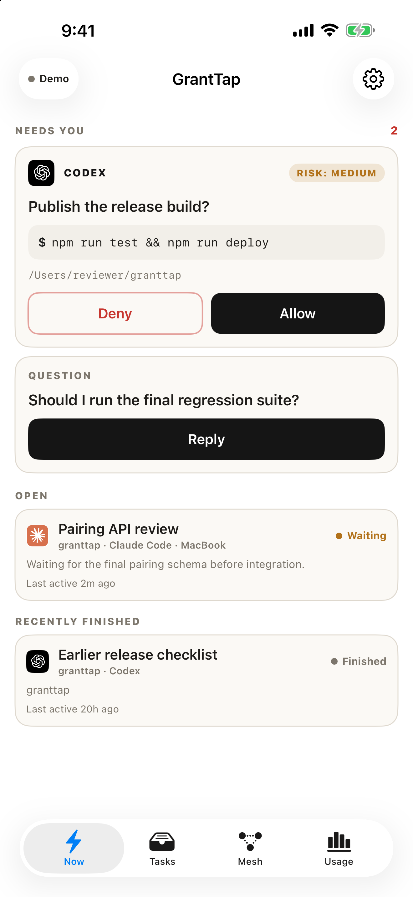
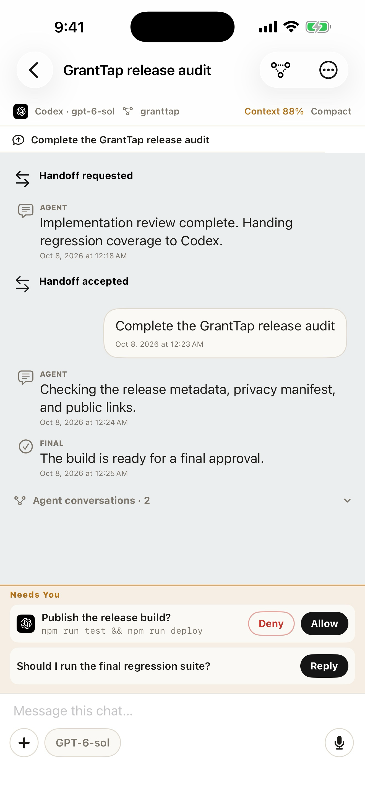
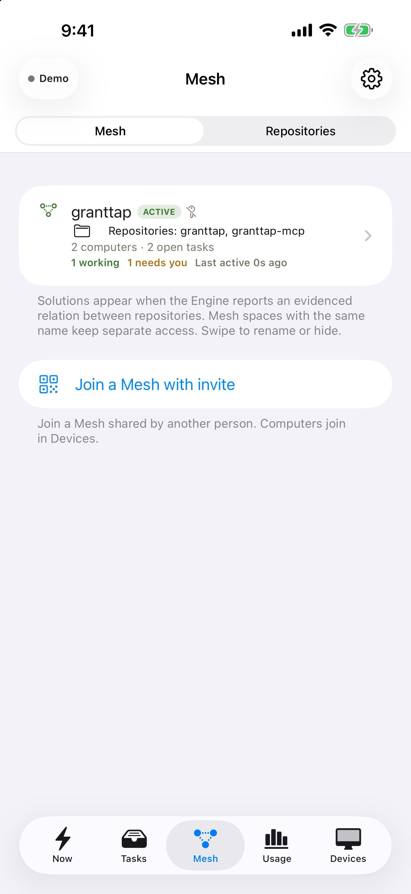

# GrantTap for iPhone, iPad, Apple Watch and Mac

> **See the work. Make the decision. Keep the Task moving.**

GrantTap is a live control center for the coding agents on your computers. See
which Task needs you, answer approvals and questions with context, send the next
message, and return to the same conversation from iPhone, iPad or Apple Watch,
without losing its history when a session or computer changes.

<a href="https://apps.apple.com/app/id6809739366"></a>

**GrantTap 1.0.2 for iPhone and iPad is a free download on the
[App Store](https://apps.apple.com/app/id6809739366).** Plans are bought in the
app through Apple. Apple Watch is a companion to the iPhone app. GrantTap 1.0.1
for Mac is in App Review: it is available in TestFlight now and comes to the Mac
App Store after Apple approves it.

## How the pieces fit

```text
 Your computer                         GrantTap Relay              Your devices
 Claude Code · Codex · Cursor ·  <=>   ciphertext only:     <=>    GrantTap for iPhone and iPad
 Grok Build + GrantTap MCP             routes, queues, wakes        Apple Watch through iPhone
```

- **GrantTap app** (this repository's Apple client source) — Now, Tasks, chats,
  approvals, questions, Mesh, Health and usage on iPhone, iPad, Apple Watch and Mac.
- **[GrantTap MCP](https://github.com/sergii-ziborov/granttap-mcp)** — the
  runtime on each coding computer. Install it with `npm install -g granttap-mcp`,
  then run `granttap setup` and scan its one-time QR in the app.
- **[GrantTap Relay](https://github.com/sergii-ziborov/granttap-relay)** — carries
  end-to-end encrypted traffic between them and keeps it while a device sleeps. It
  sees routing metadata and ciphertext, never the content.

## What's new

In GrantTap 1.0.2 for iPhone and iPad:

- rename, star and flag chats; starred chats get their own section in Now and Tasks;
- edit a Mesh's repositories from the phone and rename a Mesh from its screen;
- choose a New Task's Mesh from a searchable list, and search Repositories by
  name, remote, Mesh or branch;
- the model button shows the reasoning effort a chat runs with.

With GrantTap MCP 0.8.195 on the computer, the connection card in Claude
(including the Claude desktop app), Codex, Cursor and Grok Build lists the phones
paired with that computer and removes unused ones after a yes on a phone; the
computer can be linked to your account with a passkey; runtime updates install
automatically, with an Off switch on the card; and everything that passes the
relay stays end-to-end encrypted.

Coming in the next iPhone and iPad update (1.0.3), after Apple approves it:

- runs a chat started hang beneath it in Now, Tasks and History, with how each ended;
- review a chat's uncommitted changes and commit them from the phone;
- **Devices** lists every phone a computer accepts and everything signed in to
  your account, with Remove and Sign out;
- passkey sign-in on the first screen, and sign-in on granttap.com by scanning
  the QR on its account page.

## Agents and Tasks

A Task keeps its identity and history across provider sessions and computers.
Claude Code and Codex support the primary control paths. Cursor joins the Task
view and supported local controls; Grok Build appears where its installed
integration can report reliable work. Each provider shows the control depth it
actually supports. Provider accounts and model tokens are separate from
GrantTap purchases.

[Explore the product](https://granttap.com) · [Read the journal](https://granttap.com/blog) ·
[See availability](https://granttap.com/#availability)

## The app in action

| Now on iPhone | Task conversation | Project Mesh |
| --- | --- | --- |
|  |  |  |

These are GrantTap app screens with sample tasks and computers. They do not
show private user work or claim a live repository scan. Apple Watch offers a
compact [Needs You view](apps/ios/AppStore/Screenshots/en-US/Apple-Watch-46mm/01-root.jpg)
and [approval screen](apps/ios/AppStore/Screenshots/en-US/Apple-Watch-46mm/02-approval.jpg),
also captured with sample work.

## Mac

The Mac app uses the shared Apple client and the separately installed
[GrantTap MCP](https://github.com/sergii-ziborov/granttap-mcp). It detects the local
runtime, or offers installation when missing. Network connections are managed
in Settings. The release app requests explicit access to the local MCP through
an authenticated loopback connection compatible with the App Sandbox.

## Connect devices

Scan the Mac's QR code to pair an iPhone or iPad directly. A GrantTap account
offers a passkey alternative: link the Mac or its MCP service to the account,
then sign in with the same passkey on the phone to find that Mac. The Mac
encrypts a fresh pairing offer for the phone; the account service relays it
without receiving the pairing secret. The account shows linked computers and
lets you revoke their access. Passkeys need a network connection; QR pairing
remains available without an account.

GrantTap 1.0.1 for Mac is in App Review and available in TestFlight until Apple
approves it; the Mac License cannot be bought before then. It is **USD 39.99
once**, sold in the Mac app: the universal configuration is a free download with
a non-consumable Mac unlock. Final storefront prices and availability are
determined by Apple's purchase sheet. The iPhone and iPad download is free.

A purchased Mac license includes local control and running your own relay for
personal or internal use. It remains valid when a Personal subscription ends,
subject to refunds or revocation. Development builds are evaluation builds and
do not represent a verified production purchase.

## Optional Personal subscription

The managed plans, bought through Apple in GrantTap for iPhone and iPad, are
**Personal $4.99/month for up to 2 computers**, **Personal Plus $7.99/month for
up to 5**, and **Fleet $13.99/month for up to 15**. All core features are shared. Only managed
publishing computers are counted; agents, Tasks and approvals are not billed
separately. AI accounts and tokens remain separate, and technical limits apply.
Active Personal includes linked Mac managed-client access without an additional
Mac Local purchase. A controller-only Mac uses no publishing-computer seat.
Apple's purchase sheet controls availability, localized pricing and eligible
seven-day trial offers. These are US prices; there are no annual plans.
Restore and manage purchases in Settings. Official TestFlight builds
include full access without a subscription.

Manage or cancel always opens Apple's subscription settings directly. Eligible
subscribers may receive one discounted month, once per account; Apple's sheet
shows the localized offer price and regular renewal. Cancellation feedback is
optional and is never required to open Apple's cancellation controls.

Without Personal, a licensed Mac can use encrypted endpoint discovery with
direct traffic, or an entirely self-hosted relay. The phone periodically resolves
the announced address while active. Supply a reachable TLS endpoint or VPN;
announcing an address does not configure NAT, router ports or APNs. Own-relay
installation and controls live in Mac Settings. Apple Watch uses its iPhone.

See [purchase and connection modes](docs/subscriptions.md),
[Mac EULA](apps/macos/DESKTOP_EULA.md), [Terms](https://granttap.com/terms),
[Privacy](https://granttap.com/privacy) and [Support](https://granttap.com/support).

## Build and inspect

- [Shared Apple client and Xcode project](apps/ios/README.md)
- [Mac build instructions](apps/macos/README.md)
- [Mac App Store configuration and listing](apps/macos/AppStore/README.md)
- [Third-party notices](apps/ios/THIRD_PARTY_NOTICES.md)

Xcode 26 and XcodeGen generate/build the shared app. The checked-in project
supports iPhone/iPad, Watch and Mac Catalyst. `bash apps/macos/build-app.sh`
creates the local Mac evaluation build. That ad hoc build is neither an App
Store upload nor a notarized distribution. The separate read-only desktop
inspector remains available through `build-inspector-app.sh`.

## Source and license

The publicly readable Apple/Mac source uses the
[GrantTap Commercial Source License](LICENSE), with the Mac end-user terms
above. It is not an MIT grant to redistribute or resell the application.
Earlier copies validly released under MIT retain their original rights.
Third-party components keep their own licenses. MCP/CLI 0.8.76 onward uses the GrantTap Commercial Source License;
versions through 0.8.75 retain Apache-2.0;
[relay](https://github.com/sergii-ziborov/granttap-relay) and
[website](https://github.com/sergii-ziborov/granttap-site) have their own licenses.

`PUBLIC_SOURCE.json` records the source revision and SHA-256 of each exported
file. This snapshot contains app/runtime-facing source, tests, public help and
build resources. Internal plans, account credentials and local build state are
excluded. Report vulnerabilities using [Security](SECURITY.md).

## Mesh and repositories

The Mesh screen includes a pinned **Mesh / Repositories** switch on Mac, iPad
and iPhone. Repository details show their original Mesh scopes and chat
executions. Mesh chat rows show repository identity and branch, with earlier
executions, conflicting reports and missing Git evidence labeled explicitly.
Each chat keeps its Task ID, history and Mesh permissions.

### Repository activity and automatic task placement

On Mac, iPhone and iPad, Mesh → Repositories shows working repositories first.
Repository details include related tasks and Mesh scopes, observed branches,
working tree state, recent commits and contributors. Git observations require
MCP 0.8.29 source or later; missing data is shown explicitly. Tasks started in
another Mesh are presented under the unique visible Mesh matching their
confirmed execution repository. Original Task IDs, history and permissions
remain intact, with links explaining where the task started.

## About, Help and legal documents

On Mac, **GrantTap → About GrantTap** and **Help → GrantTap Help** open the
main-window Settings flow. Help, Terms, Privacy, licenses and pricing are bundled
in English and Russian for offline reading on Mac, iPhone and iPad. Help covers
device pairing, local MCP authorization, purchase recovery and all three
connection modes. The public website carries the same customer documents.
